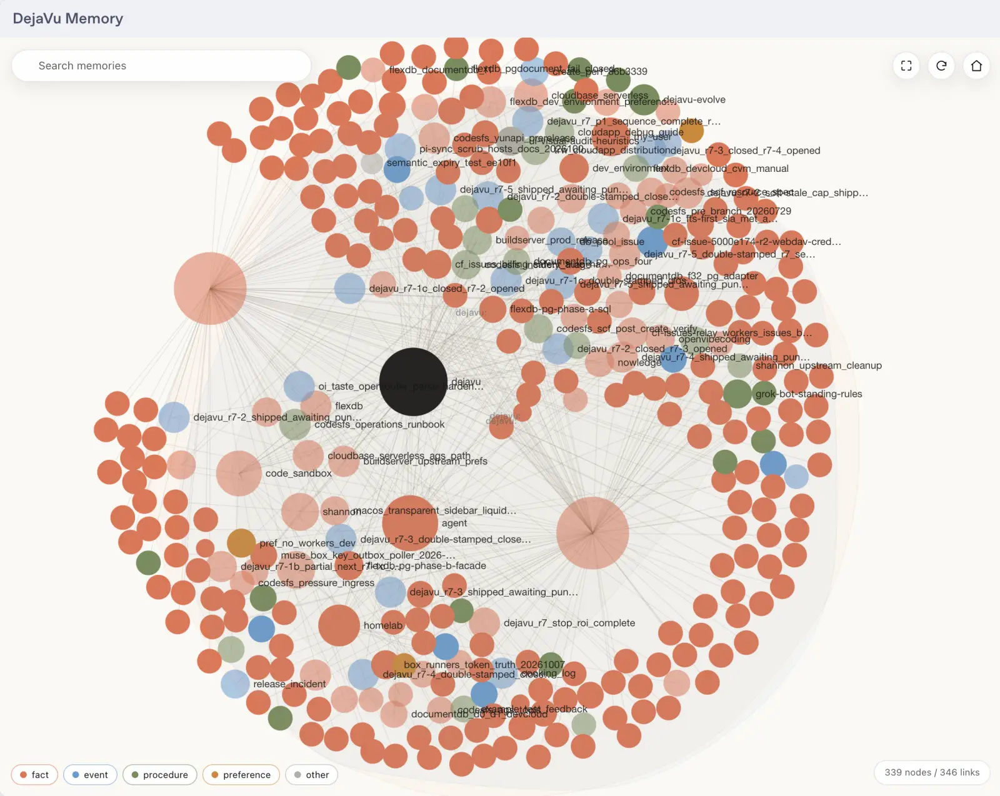

# pi-dejavu-memory

> **Renamed:** former npm/GitHub package `pi-noc-memory` → **`pi-dejavu-memory`**. Prefer this package.


<p align="center">
  
</p>

**DejaVu extension for Pi — automated memory management with SessionStart boot protocol.**

Agent-side companion to [DejaVu](https://github.com/RealAlexandreAI/DejaVu) (the Cloudflare-hosted MCP memory server). Also available for dsh: [dsh-dejavu-memory](https://github.com/RetiredPhysicist/dsh-plugins/tree/main/packages/dsh-dejavu-memory).

There is also a **ChatGPT and Codex plugin**, [dejavu-memory](https://github.com/RetiredPhysicist/openai-plugins/tree/main/plugins/dejavu-memory) — the same memory server, but with an interactive knowledge graph of the tree inside the chat client. This Pi extension stays tool-only.

<p align="center">
  
</p>

<p align="center">
  
</p>

## Features

- **SessionStart Boot Protocol** — automatically calls `dejavu_boot` (reads `system://boot`, `system://recent/5`, `system://triggers`, then best-effort `system://briefing`) at session start; then read `system://focus` to resume active working trees (`recent` is a briefing subset — no need to re-read it after boot)
- **Memory Rules** — global rules injected every session for intelligent memory usage (write-judgement, update-over-create, trigger discipline)
- **Memory Tools** — `dejavu_read`, `dejavu_create`, `dejavu_update`, `dejavu_delete`, `dejavu_search`, `dejavu_alias`, `dejavu_triggers`

## Install

```bash
pi install npm:pi-dejavu-memory
```

> **Upgrading from pi-nocturne-memory (≤1.0.x):** the package was renamed to `pi-dejavu-memory` and tools renamed from `nocturne_*` to `dejavu_*`. Old config at `~/.pi/agent/extensions/pi-nocturne-memory/config.json` is still read as a fallback, so your MCP URL/credentials keep working — just reinstall the new package and update any prompt text that referenced `nocturne_*` tools.

## Configure

Add to `~/.claude/rules.md` or project rules:

```markdown
- DejaVu memory rules (from pi-dejavu-memory extension)
```

Set your MCP endpoint (new path, or legacy `pi-nocturne-memory` path):

```json
{ "mcpUrl": "https://dejavu.example.com/mcp", "mcpHeaders": { "CF-Access-Client-Id": "<service-token-id>", "CF-Access-Client-Secret": "<service-token-secret>" } }
```

For servers behind Cloudflare Access (e.g. dejavu.example.com), pass the **service token** headers instead of `mcpAuth`:

```json
{
  "mcpUrl": "https://dejavu.example.com/mcp",
  "mcpHeaders": {
    "CF-Access-Client-Id": "your-client-id",
    "CF-Access-Client-Secret": "your-client-secret"
  }
}
```

`mcpHeaders` is merged into every MCP request; `mcpAuth` (Authorization) can be combined if the server also accepts it.

## How It Works

1. **SessionStart Hook** — triggers boot at session start
2. **Agent calls `dejavu_boot`** — loads `system://boot`, `system://recent/5`, `system://triggers`, then best-effort `system://briefing`
3. **Agent reads `system://focus`** — resume active working trees (`recent` already covered by boot/briefing)
4. **Global Rules** — memory operation rules injected every session
5. **Agent uses memory tools** — read/create/update/delete based on rules

## Why dejavu_* (not nocturne_*)?

Some agents probe for `read_mcp_resource` before reaching for a memory tool, which wastes a round trip ([upstream issue #32](https://github.com/Dataojitori/nocturne_memory/issues/32)). The `dejavu_boot` / `dejavu_read` naming, plus the boot protocol text in the rules, steers models to the right tool explicitly — no resource shim needed.

## License

MIT

## Related

- [DejaVu](https://github.com/RealAlexandreAI/DejaVu) — the MCP memory server this extension talks to
- [dejavu-memory for ChatGPT and Codex](https://github.com/RetiredPhysicist/openai-plugins/tree/main/plugins/dejavu-memory) — same memory server, with an interactive knowledge graph
- [dsh-dejavu-memory](https://github.com/RetiredPhysicist/dsh-plugins/tree/main/packages/dsh-dejavu-memory) — same memory tools for dsh
- [nocturne_memory](https://github.com/Dataojitori/nocturne_memory) — upstream project
